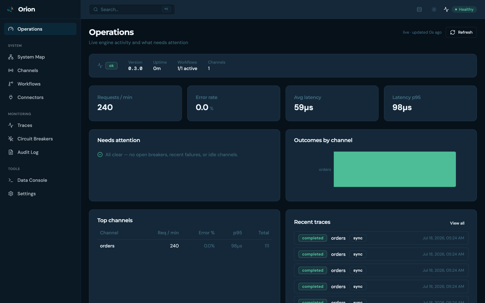
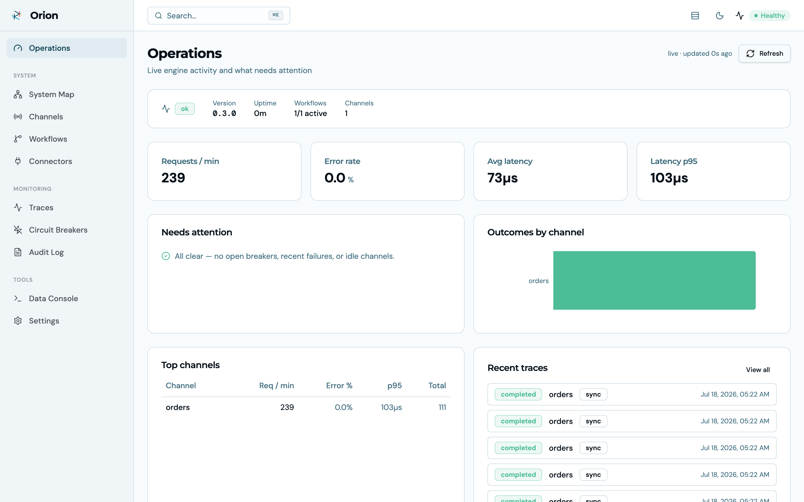
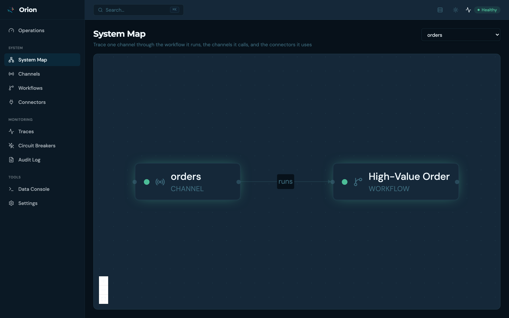
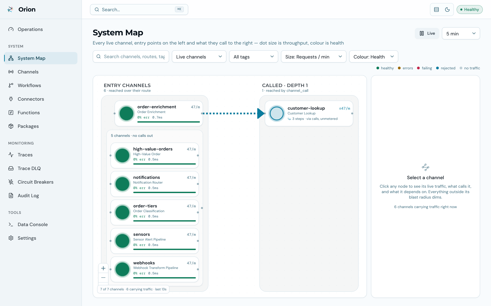
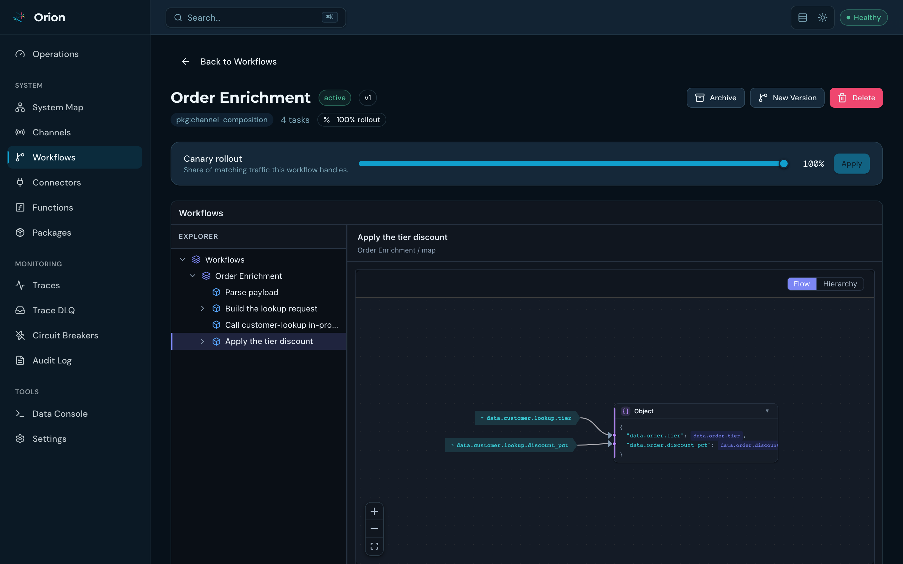
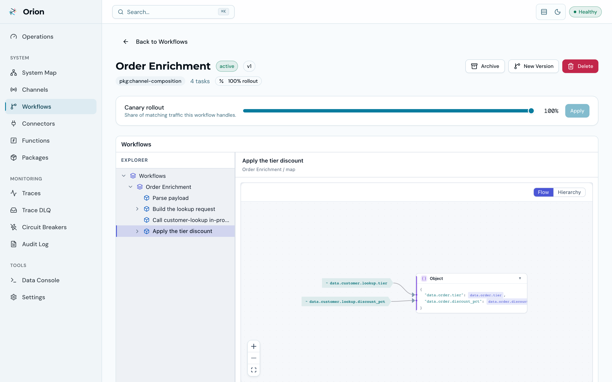
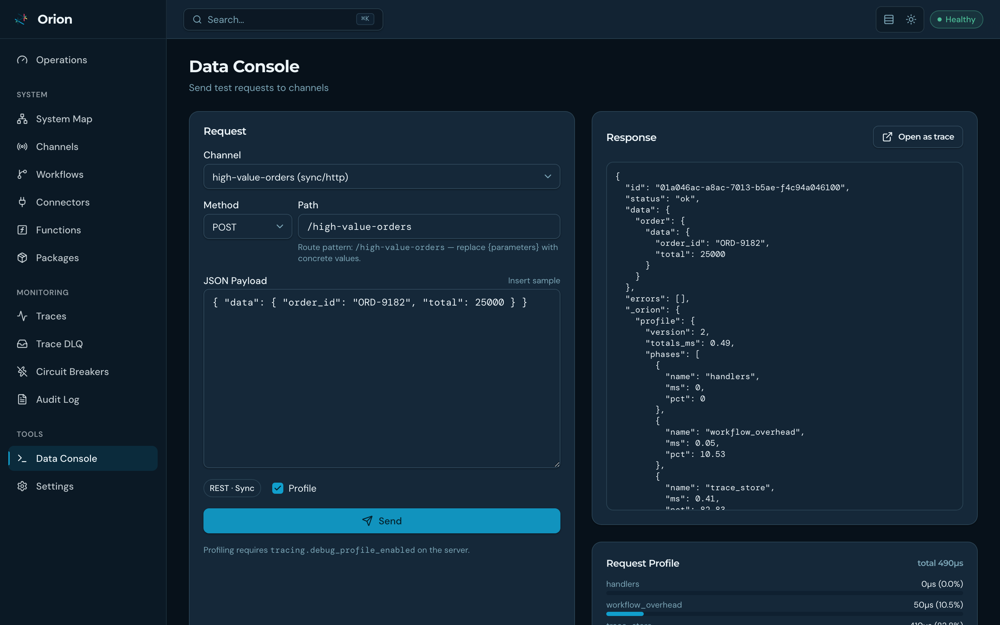
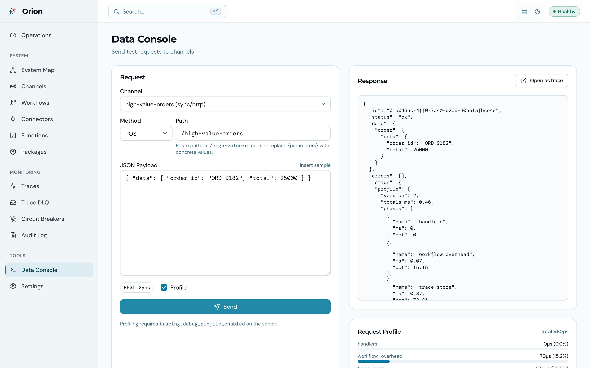

<!-- description: Run the Orion Console against an Orion 1.x server, and use the CLI views that replace it on an Orion 2 node, where it does not connect. -->
<!-- type: guide -->
<!-- last_verified: 2026-10-25 -->

# Use the Orion Console

[Orion UI](https://github.com/GoPlasmatic/Orion-ui) is a browser console over the admin API, with dashboards, a system map, trace drill-downs and a data console. Its current release targets Orion 1.x. This guide runs it against a 1.x server and lists the commands that give the same views on an Orion 2 node.

## Before you start

Tested with Orion 1.12.0. You need Docker and a running Orion server on port 8080. The command below starts the console on port 8081. On Linux, `host.docker.internal` may need Docker's `host-gateway` mapping; the Orion UI repository documents the alternatives.

The console calls the admin API under `/api/v1/admin/` and the data plane under `/api/v1/data/`. An Orion 2 node serves only `/api/v2/`, so every console call answers `404` there. The console also edits workflows, channels and connectors one at a time. An Orion 2 node accepts definitions only as a [deployment](../../concepts/deployments.md).

## Run it against an Orion 1.x server

The UI ships as a container image (nginx, multi-arch):

```bash
docker run --name orion-console -p 8081:8080 \
  -e ORION_URL=http://host.docker.internal:8080 \
  ghcr.io/goplasmatic/orion-ui:latest
```

Open `http://localhost:8081`. `ORION_URL` points at your Orion server, and the bundled nginx reverse-proxies all `/api/` requests to it. The console and the server must come from one release line. For anything you depend on, pin the image tag to your server's version.

## Get the same views on an Orion 2 node

Every read-only view the console offers has a CLI or API equivalent on Orion 2:

| Console view | On an Orion 2 node |
|---|---|
| Operations dashboard | `GET /metrics` scraped by Prometheus, and `orion-cli health` |
| System map | `orion-cli engine status`, and the head's members from `GET /api/v2/admin/deployments/{revision}` |
| Trace search and drill-down | `orion-cli traces list` and `orion-cli traces get <id>` |
| Data console | `orion-cli send <channel> -d '<json>'` |
| Circuit breakers | `GET /api/v2/admin/connectors/circuit-breakers` |
| Audit log | `orion-cli audit-logs list` |
| Schedules | `orion-cli cron status` and `orion-cli cron list` |

To change what an Orion 2 node serves, compile the definition set and apply it with `orion-cli deployments apply -d`, as in [Build your first service](../../get-started/tutorials/first-service.md).

## Verify

On the 1.x server, open the Operations dashboard. It shows live request rate, error rate, latency percentiles, outcomes by channel, top channels and recent traces:

<div class="themed-media">
  
  
</div>

On an Orion 2 node, confirm the CLI views answer:

```bash
orion-cli health
orion-cli engine status
orion-cli traces list --limit 5
```

## What the console shows

### System map

Pick any channel and trace it through the workflow it runs, the channels it calls in-process, and the connectors it touches. Every node of the graph links to its detail page.

<div class="themed-media">
  
  
</div>

### Workflow logic

On a workflow's detail page, each task's JSONLogic renders as a flow graph, beside the raw JSON:

<div class="themed-media">
  
  
</div>

### Data console

Send test requests to any channel, sync or async, and inspect the response, per-task timings and the resulting trace:

<div class="themed-media">
  
  
</div>

## Clean up

Stop the container, then remove it:

```bash
docker stop orion-console && docker rm orion-console
```

The console holds no state of its own, so removing it changes nothing on the server.

## Next steps

- [Build your first service](../../get-started/tutorials/first-service.md): compile two files and deploy them to an Orion 2 node.
- [Monitor and alert](../../operate/run/monitoring.md): the metrics behind a dashboard, and what to alert on.
- [Traces and async processing](../../operate/run/traces.md): reading what each request did, from the CLI or the API.
- [CLI](../../reference/cli/index.md): every `orion-cli` command in the table above.
